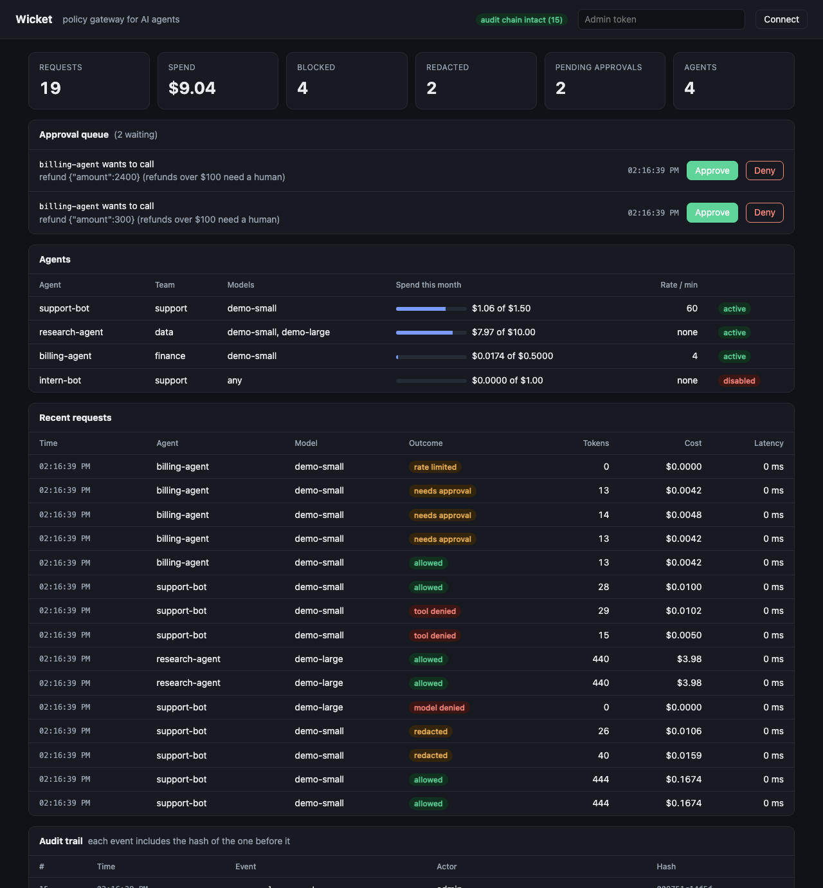
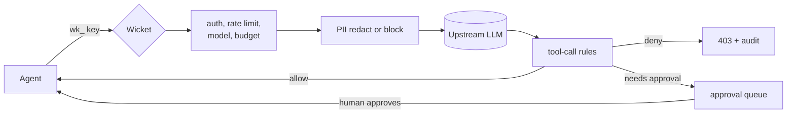

# Wicket

[](https://github.com/sungwoonpk/Wicket/actions/workflows/ci.yml)

A gateway that sits between AI agents and LLM providers. Every agent gets its own key, a budget and a model allow list. Sensitive data is masked before it leaves, risky tool calls are blocked or held for a human, and every decision goes into a tamper-evident audit trail. Written in TypeScript with no runtime dependencies.


## Why

Agents act through tools, and most teams have no control point in front of them. Surveys of teams building with agents in 2026 keep landing on the same gaps: security and governance rank as the top pain, few organizations monitor agent traffic end to end, and cost is hard to see. Wicket is one place to close those.

| What goes wrong | What Wicket does |
| --- | --- |
| One shared API key, no idea which agent did what | A key per agent, every request logged against it |
| Customer data ends up in a prompt | Emails, SSNs, card numbers, phone numbers and API keys are masked, or the request is blocked |
| An agent calls `delete_customer` or issues a $2,400 refund | Rules deny the call, or hold it until a person approves |
| A loop burns the month's budget overnight | Monthly budget per agent, per-minute rate limit, model allow list |
| "What did the agent do?" has no trustworthy answer | Hash-chained audit trail, verified on demand |

## What it does

- **OpenAI-compatible proxy.** `POST /v1/chat/completions`, including streaming. Point an existing client at Wicket by changing its base URL and key.
- **Agent identity.** A key per agent (`wk_...`), stored only as a SHA-256 hash and shown once. Agents can be disabled instantly.
- **Access controls.** Allowed models, monthly budget in dollars, requests per minute. Each refusal says why.
- **PII protection.** Detectors for email, SSN, credit card (Luhn-checked), phone and provider-style API keys. Mode `redact` rewrites the prompt, mode `block` rejects it.
- **Tool-call policy.** Ordered rules on tool name and arguments with `allow`, `deny` or `require_approval`. Works on plain and streamed responses.
- **Approval queue.** A held call is stored and released to the agent only after a person approves it in the dashboard or API.
- **Audit trail.** Every denial, redaction, policy change and approval decision is chained by hash. `GET /admin/audit/verify` finds an edited or removed event.
- **Cost tracking.** Per-agent spend from token usage and a price table, including streamed responses.
- **Dashboard and metrics.** A live admin page at `/dashboard` and Prometheus metrics at `/metrics`.
- **Persistent.** SQLite file with numbered migrations, so keys, policy, logs and approvals survive a restart.

## Dashboard

<p align="center"></p>

The page is a single file served by the gateway, with no external requests. It runs under a strict content security policy and writes every value with `textContent`.

## Try it

Needs Node 22.13 or newer, the first release where the built-in `node:sqlite` works without a flag. No accounts, no keys, no network, no cost.

```bash
git clone https://github.com/sungwoonpk/Wicket.git
cd Wicket
npm install
npm run demo
```

The demo starts a mock upstream and the gateway, loads a policy and four agents, and plays a short scenario: normal questions, a message with an email and SSN, a denied `delete_customer`, refunds that wait for approval, a rate limit, a disabled agent. It then keeps running. Open the dashboard link it prints. Node prints a warning that `node:sqlite` is experimental, which is expected.

The demo uses inflated prices so spend is visible next to the budgets.

### Run it for real

```bash
npm run dev:mock                                   # mock upstream on :4010
WICKET_ADMIN_TOKEN=change-me npm run dev           # gateway on :8080
```

Create an agent and call through it:

```bash
curl -s localhost:8080/admin/agents \
  -H "authorization: Bearer change-me" -H "content-type: application/json" \
  -d '{"name":"support-bot","team":"support","allowedModels":["demo-small"],"monthlyBudgetUsd":5,"ratePerMinute":60}'

curl -s localhost:8080/v1/chat/completions \
  -H "authorization: Bearer <key from above>" -H "content-type: application/json" \
  -d '{"model":"demo-small","messages":[{"role":"user","content":"hello"}]}'
```

To use a real model instead of the mock, set `WICKET_UPSTREAM_URL` to any OpenAI-compatible server, such as a local [Ollama](https://ollama.com) at `http://localhost:11434`. Providers with their own formats need an adapter, which is not built yet.

### Configuration

| Variable | Default | Meaning |
| --- | --- | --- |
| `WICKET_ADMIN_TOKEN` | required | Bearer token for `/admin` routes and `/metrics` |
| `WICKET_UPSTREAM_URL` | `http://localhost:4010` | OpenAI-compatible upstream |
| `WICKET_DB` | `wicket.db` | SQLite file. `:memory:` for a throwaway database |
| `PORT` | `8080` | Gateway port |
| `MOCK_PORT`, `MOCK_LATENCY_MS` | `4010`, `0` | Mock upstream port and added latency |

## A policy

```json
{
  "redaction": { "mode": "redact", "detectors": ["email", "ssn", "credit_card", "phone", "api_key"] },
  "defaultToolAction": "allow",
  "tools": [
    { "tool": "delete_*", "action": "deny", "reason": "destructive tools are never allowed" },
    { "tool": "refund", "action": "require_approval",
      "when": [{ "arg": "amount", "op": "gt", "value": 100 }],
      "reason": "refunds over $100 need a human" },
    { "tool": "http_request", "action": "deny",
      "when": [{ "arg": "url", "op": "matches", "value": "^https?://(?!(api\\.)?acme\\.com)" }],
      "reason": "outbound requests are limited to acme.com" }
  ]
}
```

Load it with `PUT /admin/policy`. Rules run in order and the first match wins. Conditions read the tool's JSON arguments by dot path (`customer.id`). With several tool calls in one response, the strictest result applies.

When a call needs approval the agent gets `202` and a `poll_url`:

```json
{ "object": "wicket.approval_required", "approval_id": "apr_...", "status": "pending",
  "tool_calls": [{ "name": "refund", "args": { "amount": 850 }, "reason": "refunds over $100 need a human" }],
  "poll_url": "/v1/approvals/apr_..." }
```

Polling returns `202` while pending, then the original response (`200`) once approved, or `403` if denied.

## API

Agent routes use the agent's key. Admin routes and `/metrics` use the admin token.

| Route | What it does |
| --- | --- |
| `POST /v1/chat/completions` | OpenAI-compatible completion, streamed or not |
| `GET /v1/approvals/:id` | Agent polls a held tool call |
| `POST /admin/agents` | Create an agent and return its key once |
| `GET /admin/agents` | List agents with spend this month |
| `PATCH /admin/agents/:id` | Change name, team, models, budget, rate limit, or disable |
| `GET`, `PUT /admin/policy` | Read or replace the policy |
| `GET /admin/requests` | Recent requests with outcome, tokens, cost, latency |
| `GET /admin/summary` | Totals for the dashboard |
| `GET /admin/approvals`, `POST /admin/approvals/:id/approve` or `deny` | Review the queue |
| `GET /admin/audit`, `GET /admin/audit/verify` | Read the trail, check the chain |
| `GET /metrics` | Prometheus text format |
| `GET /dashboard`, `GET /healthz` | Admin page, health check |

## How a request flows



Every refusal, redaction, policy change and approval decision is appended to the audit chain.

## Performance

Measured with `npm run bench`: the mock upstream, the gateway and the load client are separate processes on one laptop (Apple M3 Pro, Node 22.14), after a warm-up of 300 requests: 2,000 requests per scenario for the unloaded run, 5,000 for the saturated one. The mock answers instantly, so these numbers are the gateway's own cost on loopback, not production latency.

Unloaded (concurrency 1), latency added to a request:

| Scenario | p50 | p95 | p99 |
| --- | --- | --- | --- |
| Gateway, no policy | 0.21 ms | 0.27 ms | 0.81 ms |
| Gateway, redaction and tool rules | 0.28 ms | 0.34 ms | 0.66 ms |

Saturated (concurrency 32), one gateway process:

| Scenario | p50 | p99 | Throughput |
| --- | --- | --- | --- |
| Direct to upstream | 2.65 ms | 7.03 ms | 11,300 req/s |
| Gateway, no policy | 9.56 ms | 13.69 ms | 3,300 req/s |
| Gateway, redaction and tool rules | 16.74 ms | 22.05 ms | 1,900 req/s |

Under saturation the added latency is mostly queueing: one Node process handles about 3,000 requests a second here, and the redaction scenario also writes an audit event for every request because the test prompt contains an email address. Scale out with more processes behind a load balancer. Note that rate-limit state is per process (see Limits).

## Tests

```bash
npm run typecheck
npm test            # 65 tests
```

- **Policy engine:** every detector, Luhn filtering of card numbers, redaction of string and multi-part messages without mutating the input, first-match rules, wildcards, nested arguments, malformed arguments, strictest-wins, tool calls rebuilt from streamed fragments.
- **Stores:** key hashing and persistence across a reopened file, budgets summed per calendar month, token-bucket refill, policy validation, one-time approval decisions.
- **Audit chain:** clean log, edited event, removed event.
- **Gateway, end to end:** auth, disabled agents, proxying and streaming, upstream errors and 502, model allow list, budget and rate limit, redact and block modes, denied tool calls, held tool calls (plain and streamed) with approve and deny, agents unable to see each other's approvals, dashboard security headers, tamper detection through the API.
- **CI:** GitHub Actions runs typecheck and tests on every push and pull request.

## Repo structure

```
Wicket/
├── src/
│   ├── gateway/
│   │   ├── server.ts        HTTP server: the request pipeline and the admin API
│   │   ├── agents.ts        Agent registry, key hashing
│   │   ├── requests.ts      Request log, monthly spend, summaries
│   │   ├── approvals.ts     Approval queue
│   │   ├── audit.ts         Hash-chained audit trail
│   │   ├── policystore.ts   Policy validation and storage
│   │   ├── pricing.ts       Token prices and cost
│   │   ├── ratelimit.ts     Token bucket
│   │   ├── metrics.ts       Prometheus output
│   │   ├── db.ts            SQLite schema and migrations
│   │   ├── dashboard.html   Admin page
│   │   └── main.ts          Entry point
│   ├── policy/              Pure functions, no I/O
│   │   ├── redact.ts        PII detectors and redaction
│   │   ├── tools.ts         Tool-call rules and extraction
│   │   └── types.ts
│   └── mock/                Deterministic OpenAI-compatible upstream
├── test/                    Unit and end-to-end tests
├── scripts/                 demo.ts and bench.ts
└── docs/                    Screenshots, demo GIF, design decisions
```

## How it works

- **Pipeline.** Auth, rate limit, model check, budget check, redaction, upstream call, tool-call rules, response. Each stage can end the request with a specific error and an audit entry.
- **Policy is pure.** `src/policy` has no I/O. Given a policy and a tool call it returns a decision, which is why it is tested without a server.
- **Storage.** SQLite through Node's built-in `node:sqlite`, so there are no runtime dependencies. Numbered migrations run on start.
- **Streaming.** Streams pass through chunk by chunk. When the request declares tools and the policy has tool rules, the stream is held, judged, then replayed or blocked.
- **Dashboard.** Plain JavaScript polling the admin API. Served with a per-request nonce and a policy that allows only that script.
- **Keys.** Compared by hash. The admin token is compared in constant time.

## Design decisions

Written down in [docs/decisions](docs/decisions):

- [0001. The gateway talks to an upstream through the OpenAI-compatible wire format](docs/decisions/0001-upstream-abstraction.md)
- [0002. Tool calls are judged on the model's response, by ordered rules](docs/decisions/0002-tool-call-policy.md)
- [0003. Held tool calls return 202 and are released by polling](docs/decisions/0003-approval-queue.md)
- [0004. The audit trail is a hash chain](docs/decisions/0004-hash-chained-audit-log.md)

## Limits

Honest list of what this version does not do:

- **One admin token.** No roles, no teams-as-tenants, no per-team policy. Policy is global.
- **Audit tail truncation is not detected.** The chain catches edits and removals in the middle, not deleting the newest events. See ADR 0004.
- **Rate limits are per process.** Several gateway processes each keep their own buckets.
- **Redaction covers requests, not responses.** The model's reply is not scanned.
- **Pattern-based detectors.** They catch common formats and will miss free-form personal data.
- **OpenAI wire format only.** Other providers need an adapter.
- **Single SQLite file.** Fine for one node, not for a fleet.
- **`node:sqlite` is experimental** in Node 22 and may change.

## Roadmap

1. Teams as tenants, roles for admins, per-team policy
2. Provider adapters (Anthropic Messages API) and response-side scanning
3. Signed audit checkpoints to detect truncation
4. Postgres and shared rate limits for running several instances
5. Evaluation replay: re-run recorded traffic against a changed policy before shipping it
