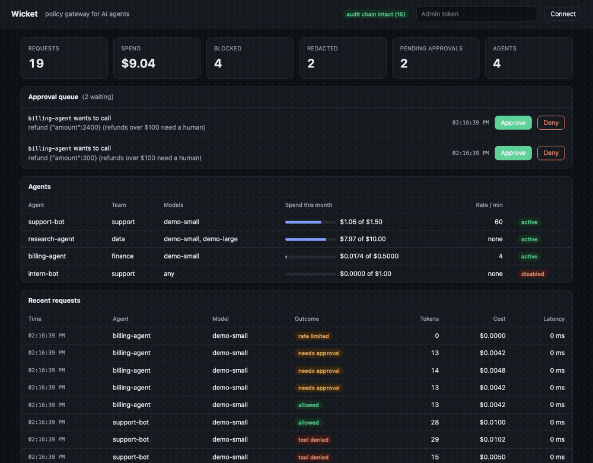
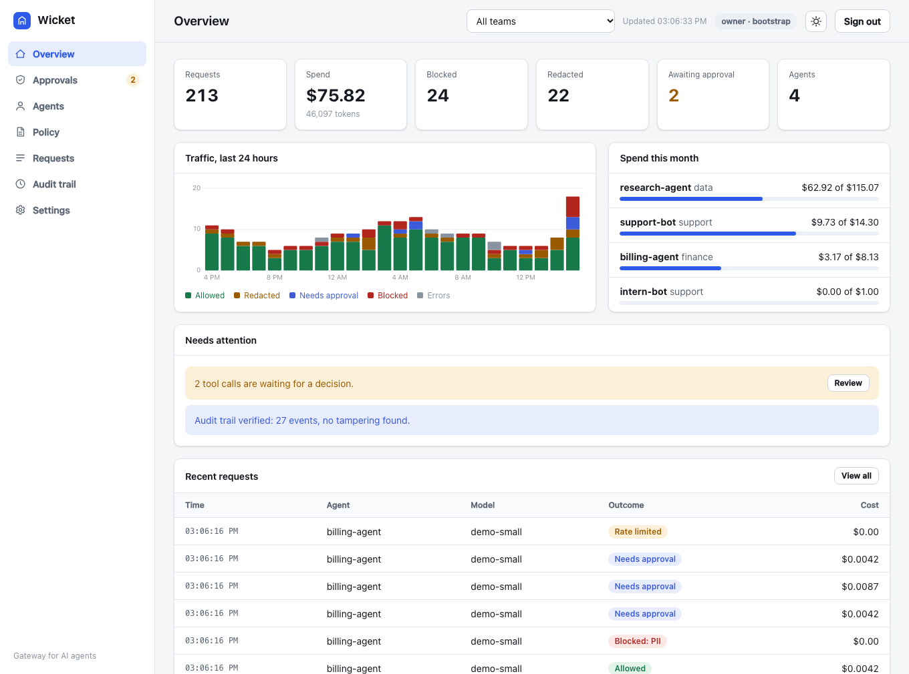
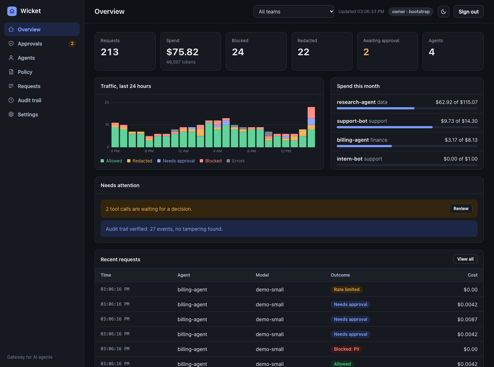
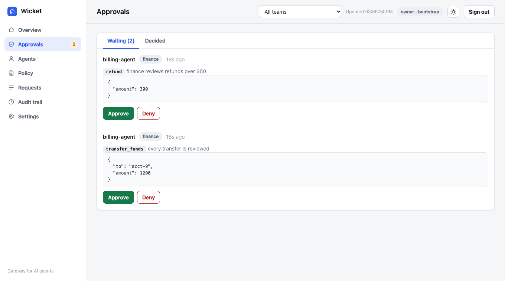
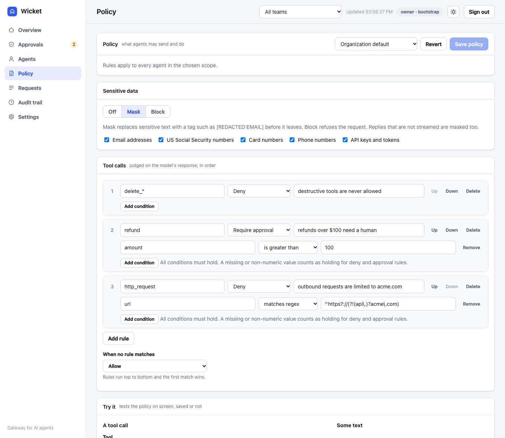
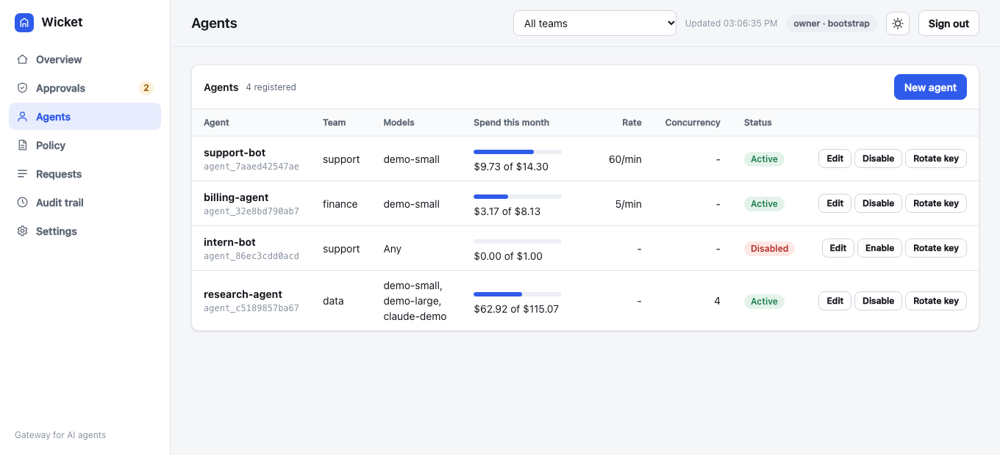
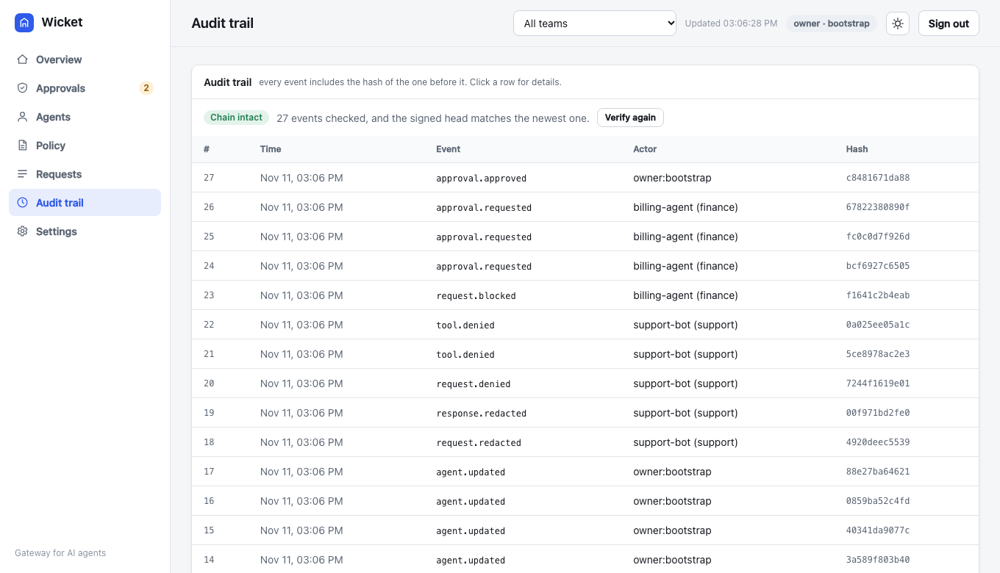
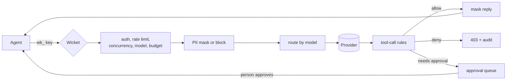

# Wicket

[](https://github.com/sungwoonpk/Wicket/actions/workflows/ci.yml)
[](https://github.com/sungwoonpk/Wicket/actions/workflows/codeql.yml)

A gateway that sits between AI agents and model providers. Every agent gets its own key, budget and limits. Sensitive data is masked before it leaves, risky tool calls are blocked or held for a person, and every decision goes into a tamper-evident audit trail. Teams, roles, per-team policy, several providers and a web dashboard are built in. Written in TypeScript with no runtime dependencies.



## Why

Agents act through tools, and most teams have no control point in front of them. Surveys of teams building with agents in 2026 keep landing on the same gaps: security and governance rank as the top pain, few organizations watch agent traffic end to end, and cost is hard to see. Wicket is one place to close those.

| What goes wrong                                            | What Wicket does                                                                       |
| ---------------------------------------------------------- | -------------------------------------------------------------------------------------- |
| One shared API key, no idea which agent did what           | A key per agent, every request logged against it, one call to rotate it                |
| Customer data ends up in a prompt                          | Emails, SSNs, card numbers, phones and API keys are masked, or the request is blocked  |
| An agent calls `delete_customer` or issues a $2,400 refund | Rules deny the call, or hold it until a person approves                                |
| A loop burns the month's budget overnight                  | Monthly budget, rate limit, concurrency cap and model allow list per agent             |
| Support can see finance's traffic                          | Teams, roles, and a view limited to one team                                           |
| Every team wants different rules                           | A policy per team, with the organization policy as the default                         |
| Several providers, keys scattered across agents            | Agents hold a Wicket key only. Wicket routes by model name and holds the provider keys |
| "What did the agent do?" has no trustworthy answer         | Hash-chained, signed audit trail that is verified on demand                            |

## What it does

**Control**

- **OpenAI-compatible proxy.** `POST /v1/chat/completions`, streamed or not. Point a client at Wicket by changing its base URL and key.
- **Agent identity and limits.** A key per agent, shown once and stored only as a hash. Allowed models, monthly budget in dollars, requests per minute, requests in flight. Each refusal says why.
- **Sensitive data.** Detectors for email, SSN, card (Luhn-checked), phone and API keys. Mask or block, per team. Text is normalized first so fullwidth digits and invisible characters do not hide anything. Replies that are not streamed are masked too.
- **Tool-call policy.** Ordered rules on tool name and arguments: `allow`, `deny` or `require_approval`. Judged on the model's response, plain or streamed. When Wicket cannot judge a call (missing amount, text where a number belongs, broken JSON) it fails **closed**.
- **Approval queue.** A held call is stored and released to the agent only after a person approves it, in the dashboard or the API.

**Organization**

- **Teams, roles and scope.** Roles `viewer`, `approver`, `admin`, `owner`. A user can be limited to one team and then sees and changes only that team.
- **Policy per team.** A team with its own policy follows that. Others follow the organization policy.
- **Providers.** Register OpenAI-compatible servers and the Anthropic Messages API. Models are routed by name pattern. Provider keys stay in environment variables.
- **Budget alerts.** Warnings at 80% and 100% of a monthly budget, once per month, in the audit trail.

**Trust and operations**

- **Audit trail.** Every denial, redaction, policy change, approval decision and admin action, chained by hash and signed at the head, so edits, removals in the middle and removal of the newest events are all detected.
- **Dashboard.** Overview with charts, approvals, agents, a policy editor with a tester, requests, audit, users, teams and providers. Light and dark.
- **Observability.** Structured JSON logs with request ids, Prometheus metrics, `/healthz` and `/readyz`.
- **Persistence.** One SQLite file with numbered migrations. Keys, policy, logs and approvals survive restarts.
- **Careful by default.** Refuses short admin tokens, listens on loopback unless told otherwise, slows down repeated wrong keys, times out slow upstreams, stops the upstream call when the caller disconnects, and shuts down cleanly.

## Dashboard

|                                    Light                                     |                                       Dark                                       |
| :--------------------------------------------------------------------------: | :------------------------------------------------------------------------------: |
|  |  |

|                                          Approvals                                          |                                       Policy editor                                        |
| :-----------------------------------------------------------------------------------------: | :----------------------------------------------------------------------------------------: |
|  |  |

|                                        Agents                                         |                                       Audit trail                                       |
| :-----------------------------------------------------------------------------------: | :-------------------------------------------------------------------------------------: |
|  |  |

The dashboard is three static files served by the gateway, with no outside requests. It runs under a strict content security policy (same-origin script and style only, no framing) and writes every value as text, never as HTML. The policy page has a **tester**: try a tool call or some text against the policy on screen, saved or not, before you save it.

## Try it

Needs Node 22.13 or newer, the first release where the built-in `node:sqlite` works without a flag. No accounts, no keys, no network, no cost.

```bash
git clone https://github.com/sungwoonpk/Wicket.git
cd Wicket
npm install
npm run demo
```

The demo starts a mock upstream and the gateway, then sets up three teams, three users, a stricter policy for finance, an Anthropic provider (served by the mock), four agents and a day of earlier traffic. It plays a scenario: normal questions, a message with an email and SSN, a reply that carries personal data, a denied `delete_customer`, a blocked outside request, refunds and a transfer that wait for approval, a card number that finance blocks, a rate limit, a disabled agent. Then it keeps running. Open the dashboard link it prints.

The demo uses inflated prices so spend is visible next to the budgets. Node prints a warning that `node:sqlite` is experimental, which is expected.

### With Docker

```bash
export WICKET_ADMIN_TOKEN=$(openssl rand -hex 24)
export WICKET_AUDIT_KEY=$(openssl rand -hex 24)
docker compose up --build
```

Open <http://localhost:8080/dashboard> and sign in with `WICKET_ADMIN_TOKEN`. The compose file starts the gateway and a mock upstream and keeps the database in a volume. The image runs as an unprivileged user and has a health check. CI builds it and waits for it to become healthy on every change.

### Run it yourself

```bash
export WICKET_ADMIN_TOKEN=$(openssl rand -hex 24)
npm run dev:mock        # mock upstream on :4010
npm run dev             # gateway on 127.0.0.1:8080
```

Create an agent and call through it:

```bash
curl -s localhost:8080/admin/agents \
  -H "authorization: Bearer $WICKET_ADMIN_TOKEN" -H "content-type: application/json" \
  -d '{"name":"support-bot","team":"support","allowedModels":["demo-small"],"monthlyBudgetUsd":5,"ratePerMinute":60}'

curl -s localhost:8080/v1/chat/completions \
  -H "authorization: Bearer <key from above>" -H "content-type: application/json" \
  -d '{"model":"demo-small","messages":[{"role":"user","content":"hello"}]}'
```

### Configuration

| Variable                       | Default                 | Meaning                                                                                  |
| ------------------------------ | ----------------------- | ---------------------------------------------------------------------------------------- |
| `WICKET_ADMIN_TOKEN`           | required                | Owner token, at least 16 characters. Always accepted, so you can recover from a lost key |
| `WICKET_AUDIT_KEY`             | derived from the token  | Signs the audit head. Set a separate secret in production                                |
| `WICKET_UPSTREAM_URL`          | `http://localhost:4010` | OpenAI-compatible upstream for models no provider matches                                |
| `WICKET_DB`                    | `wicket.db`             | SQLite file. `:memory:` for a throwaway database                                         |
| `WICKET_PRICES_FILE`           | built-in demo prices    | JSON price table, see below                                                              |
| `WICKET_UPSTREAM_TIMEOUT_MS`   | `120000`                | How long to wait for an upstream before answering 504                                    |
| `WICKET_LOG`                   | on                      | `off` silences the JSON log                                                              |
| `HOST`, `PORT`                 | `127.0.0.1`, `8080`     | Where to listen. Use `0.0.0.0` only behind a proxy                                       |
| `MOCK_PORT`, `MOCK_LATENCY_MS` | `4010`, `0`             | The mock upstream's port and added latency                                               |

A price file maps a model to dollars per million tokens. `*` is the fallback. A malformed file stops the gateway at start-up instead of pricing requests at zero:

```json
{
  "claude-sonnet": { "inputPerM": 3, "outputPerM": 15 },
  "*": { "inputPerM": 1, "outputPerM": 3 }
}
```

## Policy

```json
{
  "redaction": { "mode": "redact", "detectors": ["email", "ssn", "credit_card", "phone", "api_key"] },
  "defaultToolAction": "allow",
  "tools": [
    { "tool": "delete_*", "action": "deny", "reason": "destructive tools are never allowed" },
    {
      "tool": "refund",
      "action": "require_approval",
      "when": [{ "arg": "amount", "op": "gt", "value": 100 }],
      "reason": "refunds over $100 need a human"
    },
    {
      "tool": "http_request",
      "action": "deny",
      "when": [{ "arg": "url", "op": "matches", "value": "^https?://(?!(api\\.)?acme\\.com)" }],
      "reason": "outbound requests are limited to acme.com"
    }
  ]
}
```

Load it with `PUT /admin/policy`, or `PUT /admin/policy?team=finance` for one team. Rules run in order and the first match wins. Tool names match without regard to case, and `*` is a wildcard. Conditions read the tool's JSON arguments by dot path (`customer.id`). With several tool calls in one response, the strictest result applies.

**Fails closed.** A condition that cannot be judged counts as _holding_ for rules that deny or hold for approval, and as _failing_ for rules that allow. A refund with a missing amount, an amount written as text or broken JSON therefore meets the strict rule and never the permissive one. Regular expressions run with a 20 ms limit, so a pattern that never finishes cannot freeze the gateway. See [ADR 0008](docs/decisions/0008-fail-closed-policy.md).

When a call needs approval the agent gets `202` and a `poll_url`:

```json
{
  "object": "wicket.approval_required",
  "approval_id": "apr_...",
  "status": "pending",
  "tool_calls": [{ "name": "refund", "reason": "refunds over $100 need a human" }],
  "poll_url": "/v1/approvals/apr_..."
}
```

Polling returns `202` while pending, then the original response (`200`) once approved, or `403` if denied. The reviewer sees the arguments. The agent's `202` and the audit trail do not contain them: the trail keeps a digest.

## Teams and roles

| Role       | Can                                                                        |
| ---------- | -------------------------------------------------------------------------- |
| `viewer`   | Read agents, requests, approvals, policy and charts. Use the policy tester |
| `approver` | Everything a viewer can, and approve or deny held tool calls               |
| `admin`    | Everything above, and manage agents and team policy, read providers        |
| `owner`    | Everything: users, teams, providers and the organization policy            |

A user can be limited to one team. They then see and change only that team, and cannot reach the audit trail or provider list, which span the whole gateway. The environment token is always an owner with access to all teams. [ADR 0005](docs/decisions/0005-teams-roles-and-scope.md) explains the choices. The OpenAPI file states the minimum role of every route, and a test calls each route one role below to prove it.

## Providers

Models go to the **first enabled provider whose pattern matches**. Anything else goes to `WICKET_UPSTREAM_URL`.

```bash
# Route claude-* to the Anthropic Messages API. The key comes from the gateway's environment, never from the agent.
export ANTHROPIC_API_KEY=...
curl -s localhost:8080/admin/upstreams -H "authorization: Bearer $WICKET_ADMIN_TOKEN" -H "content-type: application/json" \
  -d '{"name":"anthropic","kind":"anthropic","baseUrl":"https://api.anthropic.com","apiKeyEnv":"ANTHROPIC_API_KEY","models":["claude-*"]}'
```

Agents keep talking OpenAI format. The adapter translates system messages, tools and tool choice, tool calls and results, usage, errors and streaming. Policy and budgets run on the translated form, so they behave the same for every provider. A local server such as Ollama is an `openai` provider at `http://localhost:11434`. Provider addresses are checked: http or https only, no embedded credentials, and cloud metadata addresses are refused.

> **Not verified against the real service.** The Anthropic adapter is tested against a mock built from the public API description. It has never been run with a real key. Text and tools are supported, images are refused. See [ADR 0007](docs/decisions/0007-providers-and-routing.md).

## API

The full description is in [docs/openapi.yaml](docs/openapi.yaml), and a test fails if it drifts from the server. In short:

| Route                                                    | What it does                                                     |
| -------------------------------------------------------- | ---------------------------------------------------------------- |
| `POST /v1/chat/completions`                              | OpenAI-compatible completion, streamed or not (agent key)        |
| `GET /v1/approvals/:id`                                  | An agent polls a held tool call (agent key)                      |
| `/admin/agents`, `/admin/agents/:id`, `.../rotate-key`   | Create, change, disable and rotate agents                        |
| `/admin/policy`, `/admin/policy/simulate`                | Read, replace or remove a policy. Try a call or text against one |
| `/admin/approvals`, `.../:id/approve`, `.../:id/deny`    | Review the queue                                                 |
| `/admin/requests`, `/admin/summary`, `/admin/timeseries` | Traffic, totals and charts                                       |
| `/admin/teams`, `/admin/users`, `/admin/upstreams`       | Organization setup                                               |
| `/admin/audit`, `/admin/audit/verify`                    | Read the trail. Check the chain and the signed head              |
| `/metrics`, `/healthz`, `/readyz`, `/dashboard`          | Prometheus text, liveness, readiness, the admin page             |

## How a request flows



Every refusal, redaction, policy change and decision is appended to the audit chain.

## Performance

Measured with `npm run bench`. The mock upstream, the gateway and the load client are separate processes on one laptop (Apple M3 Pro, Node 22.14). The mock answers instantly, so these numbers are the gateway's own cost on loopback, not production latency. Every scenario is warmed up, the scenarios take turns over five rounds, and the **median** of the rounds is reported.

Latency added to a request, with one request at a time:

| Scenario                          | p50     | p95     | p99     |
| --------------------------------- | ------- | ------- | ------- |
| Gateway, no policy                | 0.15 ms | 0.19 ms | 0.91 ms |
| Gateway, redaction and tool rules | 0.17 ms | 0.22 ms | 0.92 ms |

With 32 requests at a time, one gateway process:

| Scenario                          | p50     | p99     | Throughput   |
| --------------------------------- | ------- | ------- | ------------ |
| Direct to upstream                | 1.54 ms | 3.50 ms | 17,900 req/s |
| Gateway, no policy                | 3.71 ms | 7.82 ms | 7,900 req/s  |
| Gateway, redaction and tool rules | 4.14 ms | 7.26 ms | 7,100 req/s  |

An ordinary request runs two SQL statements: the agent lookup and the request record. Parsed policies, routing patterns and each agent's monthly spend are kept in memory and refreshed when they change, and prepared statements are reused. Because that state lives in the process, **one gateway process owns the database** (see Limits).

## Quality

See [CONTRIBUTING.md](CONTRIBUTING.md) for the commands and how the code is laid out.

```bash
npm run check          # lint, format, types, and tests with coverage gates
npm run test:ui        # every dashboard page in headless Chrome
```

- **199 tests**, run on Node 22 and 24. Coverage is 99.7% of lines, 93.0% of branches and 100% of functions, and CI fails below 95%, 85% and 95%.
- **Policy engine:** every detector, Luhn filtering, normalization tricks, first-match rules, wildcards, nested arguments, fail-closed cases, a regular expression that would never finish, tool calls rebuilt from streamed fragments.
- **Anthropic adapter:** every translation in both directions, tool use, errors, and streaming fed one byte at a time and in odd splits.
- **Stores and migrations:** hashing, persistence across a reopened file, a version 1 database brought forward, month boundaries, budget alerts once per month, every cache invalidated on every write.
- **Audit:** an edited event, a removed event, removal of the newest events, a forged head, a wrong key, a legacy database.
- **Roles and teams:** every role against every kind of route, scope on lists, counts, charts and approvals, a scoped user unable to widen the view, disabled and rotated keys.
- **Edge cases:** bad bodies and models, oversized requests, upstream errors, bad JSON from an upstream, timeouts, a caller who disconnects, concurrency and approval caps, guessing, bypass attempts, secrets kept out of the audit trail.
- **Process:** the real program refusing weak tokens, binding to loopback, writing structured logs without secrets, and stopping cleanly on SIGTERM.
- **Browser:** each page drawn in headless Chrome with no script errors, a team viewer's menu, and an agent named like an HTML tag that is shown as text and never runs.
- **Contract:** the OpenAPI file is checked against the server, including each route's minimum role.
- **CI:** lint, format, types and coverage on two Node versions, a build that is started and probed, the browser test, a container that must become healthy and run as a non-root user, a dependency audit (no runtime dependencies, nothing high or critical in tooling) and CodeQL. Dependabot keeps npm, Actions and Docker current.

## Repo structure

```
Wicket/
├── src/
│   ├── gateway/
│   │   ├── server.ts        HTTP server and routing
│   │   ├── chat.ts          The request pipeline
│   │   ├── admin.ts         The admin API, roles and team scope
│   │   ├── services.ts      Everything a handler needs, built once
│   │   ├── http.ts          Errors, body limits, JSON parsing
│   │   ├── dashboard.ts     Serves the dashboard under a strict CSP
│   │   ├── agents.ts, adminkeys.ts, teams.ts, upstreams.ts
│   │   ├── requests.ts, approvals.ts, audit.ts, policystore.ts
│   │   ├── pricing.ts, ratelimit.ts, metrics.ts, db.ts, main.ts
│   │   └── dashboard/       index.html, app.js, app.css
│   ├── policy/              Pure functions: redaction and tool rules
│   ├── providers/           OpenAI-format pass-through and the Anthropic adapter
│   └── mock/                A deterministic upstream that can also misbehave on purpose
├── test/                    Unit, integration, process and contract tests
├── scripts/                 demo.ts, bench.ts, ui-smoke.ts
├── docs/                    OpenAPI, threat model, decision records, images
├── Dockerfile, docker-compose.yml
└── .github/                 CI, CodeQL, Dependabot, PR template
```

## Design decisions

Written down in [docs/decisions](docs/decisions), each with what it costs:

- [0001. The gateway talks to an upstream through the OpenAI-compatible wire format](docs/decisions/0001-upstream-abstraction.md)
- [0002. Tool calls are judged on the model's response, by ordered rules](docs/decisions/0002-tool-call-policy.md)
- [0003. Held tool calls return 202 and are released by polling](docs/decisions/0003-approval-queue.md)
- [0004. The audit trail is a hash chain](docs/decisions/0004-hash-chained-audit-log.md)
- [0005. Teams are the unit of tenancy, and admins have a role and an optional team](docs/decisions/0005-teams-roles-and-scope.md)
- [0006. The audit head is signed, so removing the newest events is detected](docs/decisions/0006-signed-audit-head.md)
- [0007. Providers are registered, routed by model name, and translated at the edge](docs/decisions/0007-providers-and-routing.md)
- [0008. Policy fails closed when it cannot judge a call](docs/decisions/0008-fail-closed-policy.md)

## Security

[docs/threat-model.md](docs/threat-model.md) lists what is protected, from whom, how, and what is **not** covered. [SECURITY.md](SECURITY.md) says how to report a problem and how to deploy safely.

## Limits

An honest list of what this version does not do:

- **No TLS.** Run it behind a proxy that terminates TLS. Keys travel in headers.
- **One process owns the database.** Rate limits, in-flight counts and the policy, routing and spend caches live in that process. Several gateways on one file are not supported. Fixing this means a shared store.
- **Streamed replies are not scanned** for personal data. Detection is pattern based and will miss names, addresses and free-form text.
- **The Anthropic adapter has only met a mock.** Text and tools only.
- **A team policy replaces the organization policy,** it does not merge with it.
- **Keys are bearer secrets.** No single sign-on, no multi-factor sign-in, no expiry.
- **The audit key and the database must be kept apart.** Someone who has both can rewrite and re-sign the log. There is no external anchor yet.
- **Prompt injection is limited, not detected.** Wicket constrains what an injected agent can do. It does not recognize an injection.
- **`node:sqlite` is experimental** in Node 22 and may change.
- **Demo grade.** It has had no independent security review, and the Docker image has been built by CI, not by hand on the author's machine.

## Roadmap

1. Single sign-on (OIDC) and key expiry
2. Postgres and shared limits, to run several instances
3. Anchor the audit head outside the database
4. Scan streamed replies, and webhooks for new approvals
5. Run the Anthropic adapter against the real service
6. Replay recorded traffic against a changed policy before shipping it
