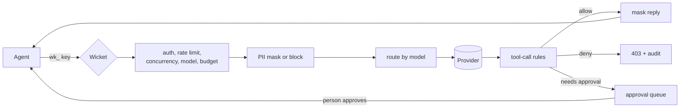

# Architecture

## How a request flows



Every refusal, redaction, policy change and decision is appended to the audit chain. A reply is masked as it
streams, holding back only the last word or number, and a reply held for approval is stored masked.

## Repo structure

```
Wicket/
├── src/
│   ├── gateway/
│   │   ├── server.ts        HTTP server and routing
│   │   ├── chat.ts          The request pipeline
│   │   ├── admin.ts         The admin API, roles and team scope
│   │   ├── services.ts      Everything a handler needs, built once
│   │   ├── http.ts          Errors, body limits, JSON parsing
│   │   ├── dashboard.ts     Serves the dashboard under a strict CSP
│   │   ├── agents.ts, adminkeys.ts, teams.ts, upstreams.ts
│   │   ├── requests.ts, approvals.ts, audit.ts, policystore.ts
│   │   ├── usage.ts         Token usage, and an estimate when none is reported
│   │   ├── keylife.ts       Key lifetimes
│   │   ├── webhook.ts       Signed, retried messages about new approvals
│   │   ├── pricing.ts, ratelimit.ts, metrics.ts, db.ts, main.ts
│   │   └── dashboard/       index.html, app.js, app.css
│   ├── policy/              Pure functions: redaction, stream masking, event streams and tool rules
│   ├── providers/           OpenAI-format pass-through and the Anthropic adapter
│   └── mock/                A deterministic upstream that can also misbehave on purpose
├── test/                    Unit, integration, process and contract tests
├── scripts/                 demo.ts, bench.ts, ui-smoke.ts
├── docs/                    OpenAPI, threat model, decision records, images
├── Dockerfile, docker-compose.yml
└── .github/                 CI, CodeQL, Dependabot, PR template
```

The reasons behind the main choices are in [decisions](decisions/README.md).
