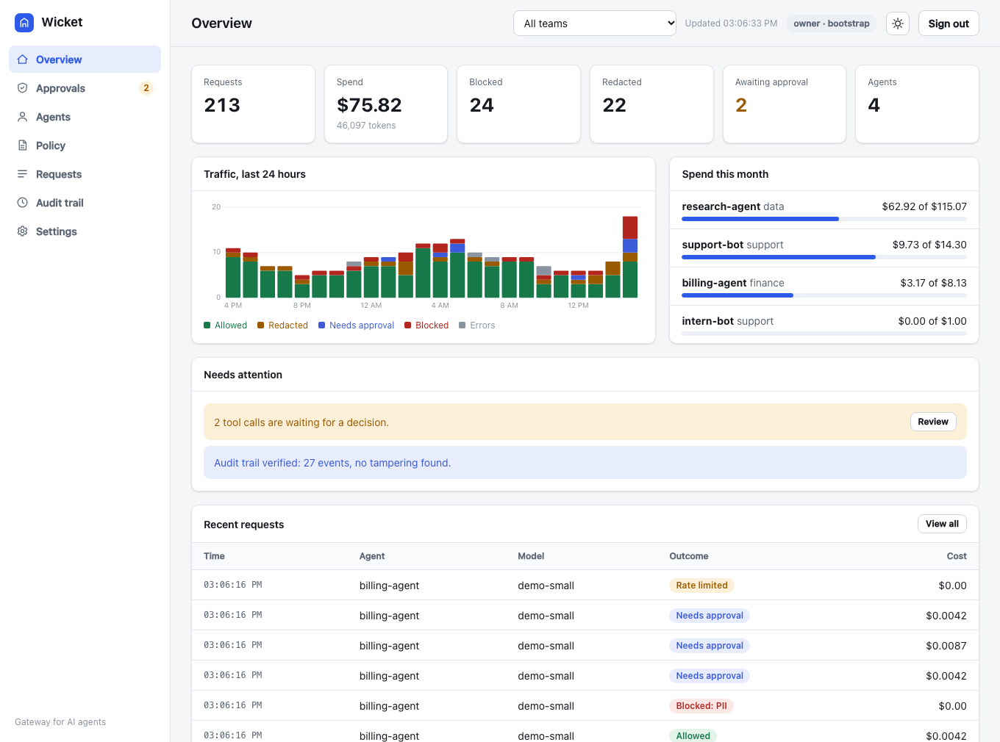
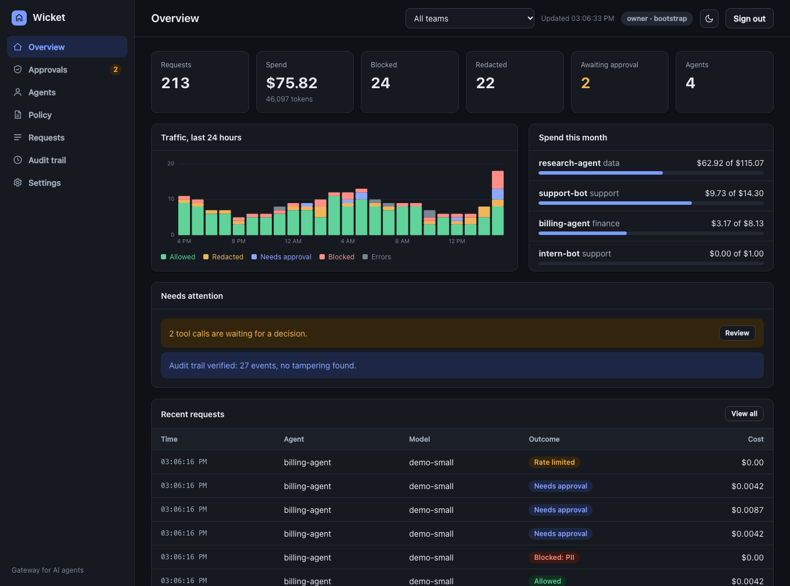
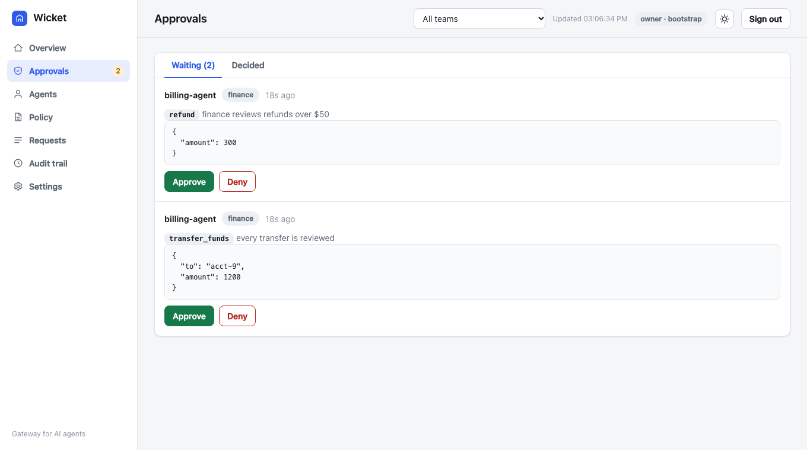
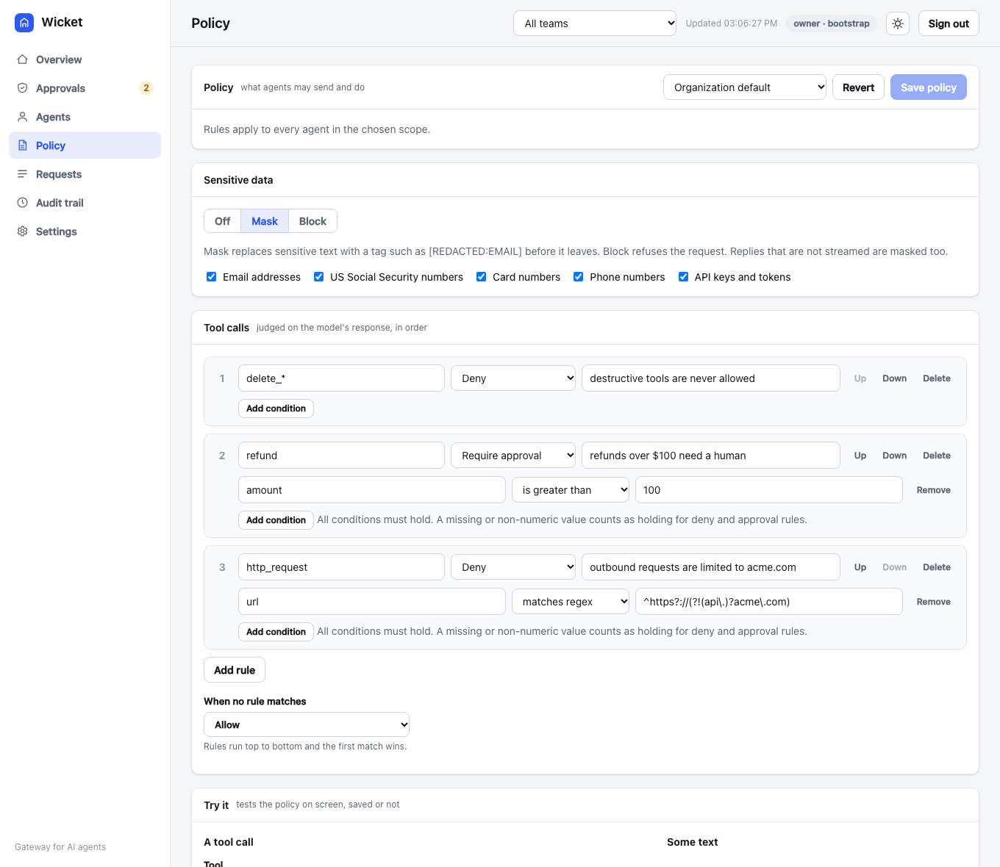
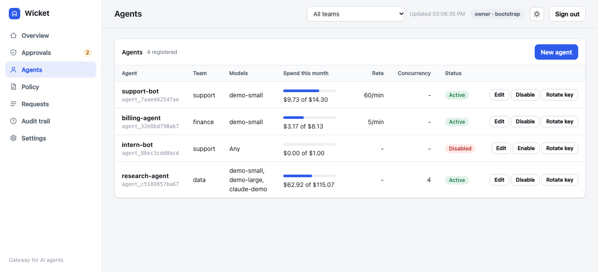
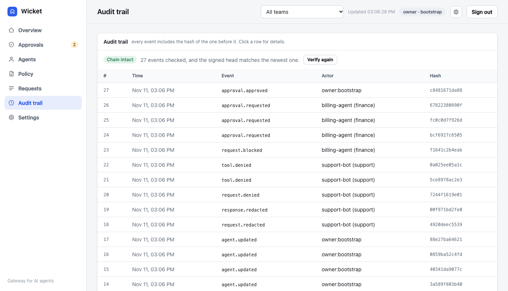

# Dashboard

|                                  Light                                  |                                    Dark                                     |
| :---------------------------------------------------------------------: | :-------------------------------------------------------------------------: |
|  |  |

|                                       Approvals                                        |                                     Policy editor                                     |
| :------------------------------------------------------------------------------------: | :-----------------------------------------------------------------------------------: |
|  |  |

|                                      Agents                                      |                                    Audit trail                                     |
| :------------------------------------------------------------------------------: | :--------------------------------------------------------------------------------: |
|  |  |

The dashboard is three static files served by the gateway, with no outside requests. It runs under a strict content security policy (same-origin script and style only, no framing) and writes every value as text, never as HTML. The policy page has a **tester**: try a tool call or some text against the policy on screen, saved or not, before you save it.
